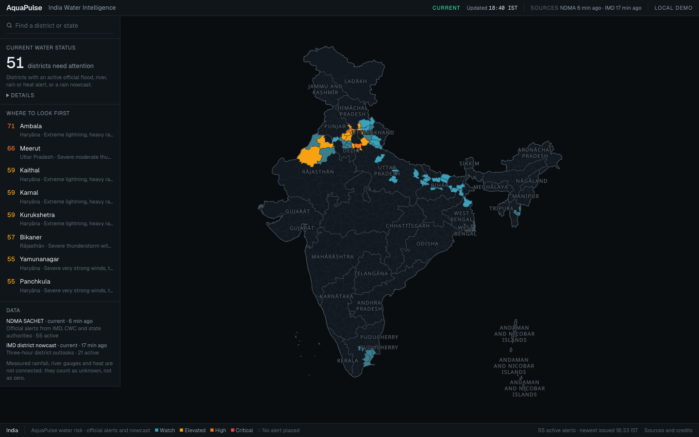
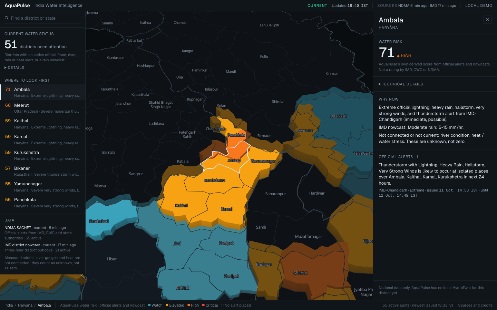
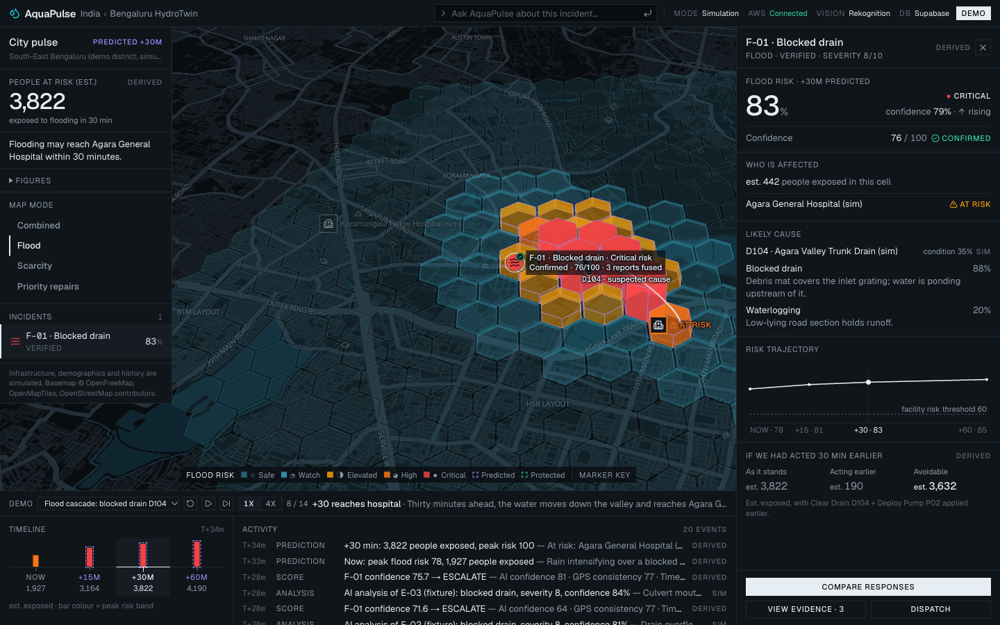
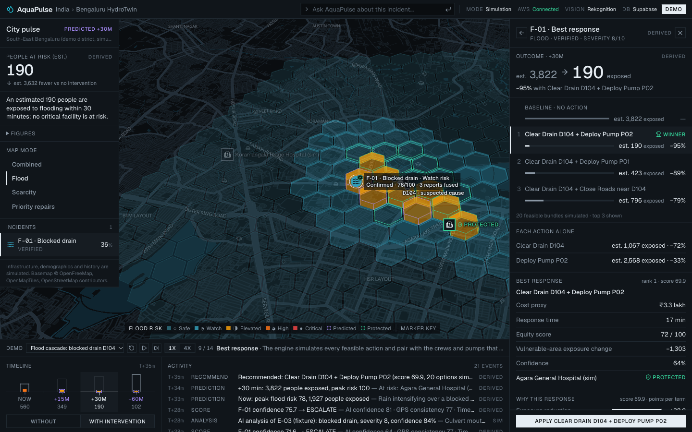
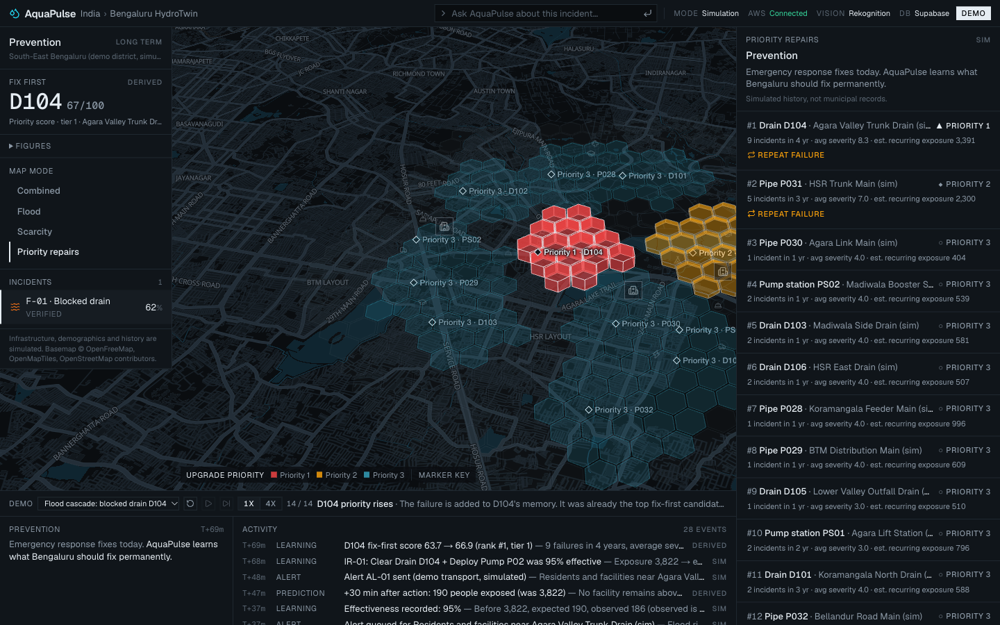
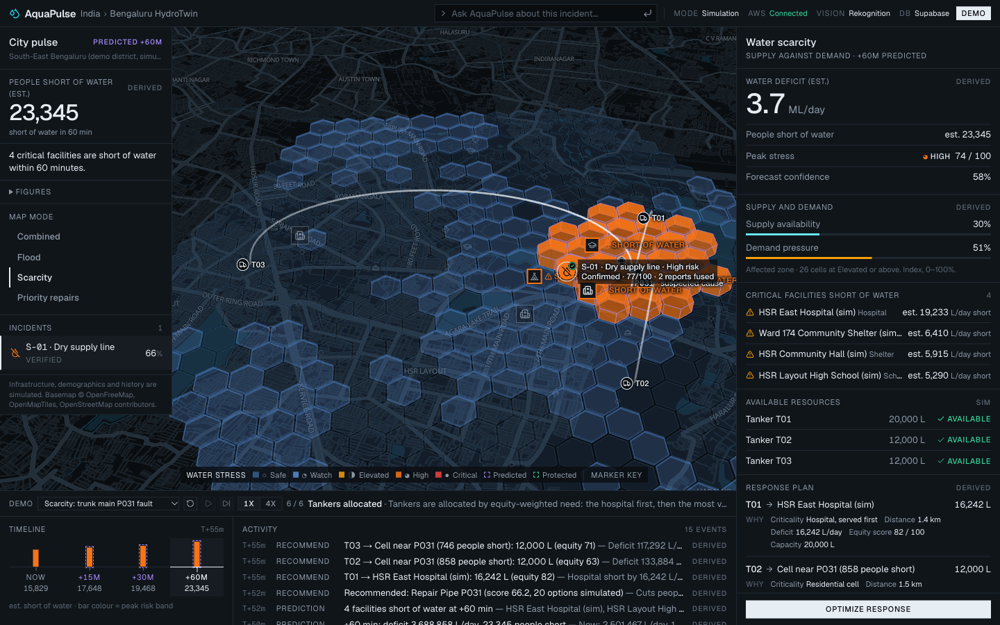
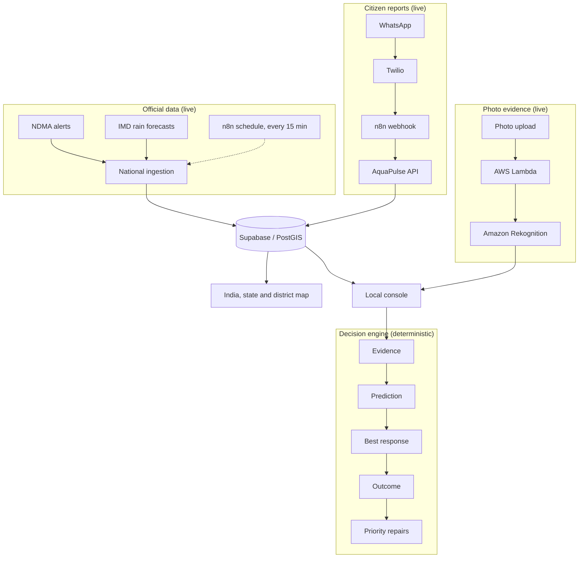

# AquaPulse

**Act before impact.**

AquaPulse helps a city respond to floods and water shortages. It answers four questions on one screen:
where is the problem, why is it happening, what happens next, and what should we do?

**Live app:** https://aquapulse-liard.vercel.app
**3-minute demo:** https://youtu.be/GUdpmlMQuSw

| | |
| --- | --- |
|  |  |
| India right now, from official NDMA and IMD data | One district: the alert text and why risk is rising |
|  |  |
| Local forecast: flooding may reach the hospital in 30 minutes | Responses compared: 3,822 people exposed down to 190 |
|  |  |
| Priority repairs: the drain that keeps failing comes first | The same engine for water scarcity |

## What AquaPulse does

- Shows water risk across India from live NDMA alerts and IMD rain forecasts, refreshed every 15 minutes.
- Drills down from the country to a state to a district, and says why risk is rising there.
- Takes citizen reports by WhatsApp: a text message and a location pin.
- Runs a local flood model (the "HydroTwin") for one Bengaluru neighbourhood: now, +15, +30 and +60 minutes.
- Warns when a hospital or other critical facility is about to be affected.
- Compares every response the available crews and pumps can deliver, and ranks them.
- Runs the same model for water scarcity and plans tankers.
- Remembers which drains and pipes keep failing and turns that into a repair list.
- Reads uploaded photos with Amazon Rekognition as visual evidence.

## One example

A drain is blocked and it is raining. In 30 minutes, 3,822 people and a hospital will be exposed to flooding.

| Response | People exposed |
| --- | --- |
| Do nothing | 3,822 |
| Deploy pump P02 | 2,568 |
| Clear drain D104 | 1,067 |
| Clear drain D104 and deploy pump P02 | **190**, and the hospital is protected |

AquaPulse simulates 20 feasible options and recommends the last one. These numbers come from a deterministic model and are pinned by a test, so they are the same every time.

## Why it is different

- It does not stop at showing alerts. It says what to do about them.
- It combines official data with reports from people on the ground.
- It predicts who and what will be affected, not only where water is.
- It compares actions before crews are sent.
- It learns from repeated failures: the drain that failed again moves up the repair list.
- One system handles both too much water and too little.

## Live vs simulated

| Feature | Status |
| --- | --- |
| National map: NDMA alerts and IMD forecasts | **Live** official data |
| District risk score | Calculated by AquaPulse from those feeds. Not a government rating |
| WhatsApp text and location | **Live**, tested from a real phone |
| Amazon Rekognition on uploaded photos | **Live** |
| Supabase / PostGIS, n8n, Twilio, AWS Lambda | **Live** services |
| Local flood forecast (Bengaluru) | Deterministic simulation. The drains, pipes, pumps, population and history are synthetic and labelled on screen |
| Scarcity scenario | Deterministic simulation |
| Photo analysis from a WhatsApp photo | Blocked: Twilio's trial account does not let us download the image |
| Amazon Bedrock | Not used in production (blocked on our AWS account) |

Inputs we do not have, such as river gauges, are shown as unknown, never as zero. Full status with evidence: [docs/STATUS.md](docs/STATUS.md).

## Architecture



The decision engine is plain TypeScript with no network calls and no randomness. It runs in the browser, so the local scenarios work even without a connection. More detail: [docs/ARCHITECTURE_FINAL.md](docs/ARCHITECTURE_FINAL.md).

## AWS usage

- **AWS Lambda** runs the photo analysis, so the website never holds AWS keys.
- **Amazon Rekognition** labels each uploaded photo (for example "Flood 100%"). Fixed rules turn the labels into a finding.
- **Amazon CloudWatch** keeps one log line per request, without secrets or image data.
- **IAM**: the Lambda's role can call `rekognition:DetectLabels` and write its own logs. Nothing else.

Everything runs in the Mumbai region (`ap-south-1`). We do not use Bedrock. Details: [docs/AWS.md](docs/AWS.md).

## Tech stack

Next.js, TypeScript, Tailwind, MapLibre, deck.gl, Supabase/PostGIS, n8n, Twilio WhatsApp, AWS Lambda, Amazon Rekognition, CloudWatch, Vercel.

## Security

- Every Twilio request must carry a valid Twilio signature. A bad signature gets a 403.
- Each message is stored once, keyed by its `MessageSid`.
- Row-level security is on for every database table; only the server can read or write.
- Media is fetched only from Twilio's hosts, over HTTPS, with size and type checks. Other addresses are refused, which blocks SSRF.
- The Lambda role has the least privilege it needs.
- Secrets stay on the server. None are in the client bundle or in this repository.

Review with evidence: [docs/SECURITY_REVIEW.md](docs/SECURITY_REVIEW.md).

## Running locally

```bash
npm install
npm run build
npm run start        # http://localhost:3100
```

The flood, scarcity and false-report scenarios need no configuration. Open `http://localhost:3100/?demo=1&scenario=flood`.

For the live integrations, copy the example file and fill in your own values:

```bash
cp .env.example .env.local
```

Variable names (no values are stored in this repository):

- AWS: `AWS_REGION`, `AI_ENDPOINT_URL`, `AI_ENDPOINT_SECRET`
- Supabase: `NEXT_PUBLIC_SUPABASE_URL`, `NEXT_PUBLIC_SUPABASE_ANON_KEY`, `SUPABASE_SERVICE_ROLE_KEY`
- Twilio: `TWILIO_ACCOUNT_SID`, `TWILIO_AUTH_TOKEN`, `TWILIO_PHONE_NUMBER`, `TWILIO_MODE`, `TWILIO_ALLOWED_TO`, `TWILIO_ACK_CONTENT_SID`, `TWILIO_FORWARDER_URL`
- Webhooks: `WEBHOOK_SECRET`

## Tests

```bash
npm run build        # run once first: it generates the route types that typecheck needs
npm test             # 58 tests: engine, scenarios, national data, webhooks
npm run typecheck
npm run lint
```

## Demo flow

1. **India, live.** Open [/live](https://aquapulse-liard.vercel.app/live): official alerts and the districts that need attention.
2. **Why now.** Click a district to see the alert text and the reason risk is rising.
3. **Citizen report.** A WhatsApp message and location pin arrive in the console.
4. **HydroTwin and the hospital.** Open the [flood scenario](https://aquapulse-liard.vercel.app/?demo=1&scenario=flood) and press `→`: the forecast reaches the hospital.
5. **Best response and repairs.** Compare the responses, apply the best one, then open Priority repairs.

Full script: [docs/DEMO_SCRIPT_FINAL.md](docs/DEMO_SCRIPT_FINAL.md). Likely questions: [docs/JUDGE_QA.md](docs/JUDGE_QA.md).

## Known limitations

- Twilio's trial account does not let us download a photo sent by WhatsApp, so only uploaded photos reach Rekognition. Replies on WhatsApp use Twilio's sample template for the same reason.
- The street-level model exists only where detailed data exists. Today that is one Bengaluru neighbourhood, and its data is synthetic.
- There is no nationwide street-level prediction. The national map shows the current situation.
- Bedrock is blocked on our AWS account, so the question box answers from templates and says so.
- The n8n Critical Alert workflow is a draft and sends nothing.
- The console has no operator sign-in yet.

## Team

Built for an AWS hackathon. The commit history is the record of the work.

## Acknowledgements

Official data from NDMA SACHET and the India Meteorological Department. Base map from OpenFreeMap, OpenMapTiles and OpenStreetMap contributors. Sources and licences: [docs/DATA_PROVENANCE.md](docs/DATA_PROVENANCE.md).

## More documentation

[Status](docs/STATUS.md) · [Architecture](docs/ARCHITECTURE_FINAL.md) · [AWS](docs/AWS.md) · [n8n and Twilio](docs/N8N.md) · [Security review](docs/SECURITY_REVIEW.md) · [Performance](docs/PERFORMANCE.md) · [Database](docs/DATABASE.md) · [National data sources](docs/NATIONAL_DATA_SOURCES.md)
