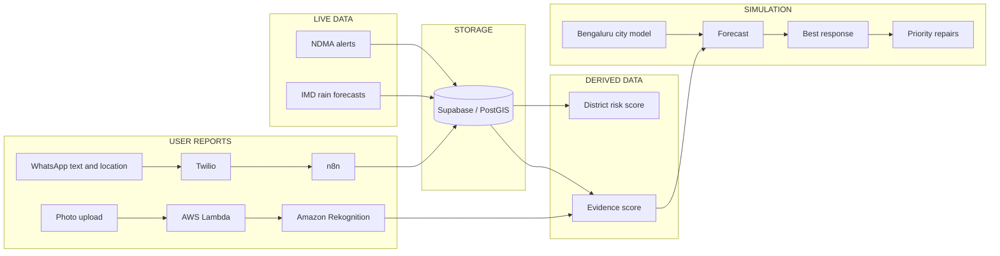

# AquaPulse architecture — one page

Production: `https://aquapulse-liard.vercel.app` (Next.js on Vercel). More detail: [ARCHITECTURE.md](ARCHITECTURE.md), [AWS.md](AWS.md), [N8N.md](N8N.md), [SECURITY_REVIEW.md](SECURITY_REVIEW.md).



## The four kinds of data

| Kind | What it is | Where you see it |
| --- | --- | --- |
| **LIVE DATA** | Fetched from official feeds: NDMA SACHET alerts and IMD rain nowcasts | India, state and district map |
| **USER REPORTS** | Sent by people: WhatsApp text and location, and photos uploaded in the console | Report notices and the evidence panel |
| **DERIVED DATA** | Calculated by AquaPulse from the two above: district risk score, evidence score, rankings | Scores and "why now" explanations |
| **SIMULATION** | Synthetic, for the demonstration: Bengaluru drains, pipes, pumps, population and failure history, and the three scenarios | Local console, labelled SIMULATED on screen |

Nothing simulated is shown under a live label.

## 1. Official data (live)

- A schedule in n8n calls the site every 15 minutes, so the data refreshes with no visitor.
- Each source has a freshness state: CURRENT, DELAYED, STALE or OFFLINE, from the time of the last successful sync. When a source fails, the last good data stays on screen with that label.
- The district water-risk score is ours. It is not a government rating.
- Inputs we do not have (river gauges, heat stress) are shown as unknown, never as zero.

## 2. User reports (live)

- WhatsApp → Twilio → n8n → `/api/webhooks/twilio` → Supabase.
- n8n forwards the request unchanged and holds no secret. AquaPulse checks Twilio's signature; a bad one returns 403.
- Each message is stored once. The sender is stored as a hash, not a phone number.
- A location pin is paired with the same sender's last report.
- An uploaded photo goes to AWS Lambda, which calls Amazon Rekognition and returns labels.
- A photo sent by WhatsApp is received and stored, but Twilio's trial account blocks the image download, so it is not analysed.
- Database: row-level security on every table, no public policies; only the server writes.

## 3. Decision engine (deterministic simulation)

```
Evidence ─► Fusion ─► Prediction ─► Best response ─► Outcome ─► Priority repairs
```

- **Evidence:** a score from 0 to 100 built from eight checks.
- **Fusion:** reports that are close in place and time become one incident.
- **Prediction:** risk per map cell for now, +15, +30 and +60 minutes, with people and facilities affected.
- **Best response:** every feasible action and pair is simulated and ranked.
- **Outcome:** expected against observed.
- **Priority repairs:** assets that keep failing rise up the list.

It is plain TypeScript with no network calls and no randomness. It runs in the browser and is covered by tests.

- Flood example: 3,822 exposed at +30 min → pump alone 2,568 → drain alone 1,067 → both 190, hospital protected.
- Scarcity example: a pipe fault raises the deficit from 2.5 to 3.7 ML/day; tankers go to the hospital first.

## Not in production

Amazon Bedrock (blocked on this AWS account; the question box uses labelled templates) and the n8n Critical Alert workflow (a draft; it sends nothing).
